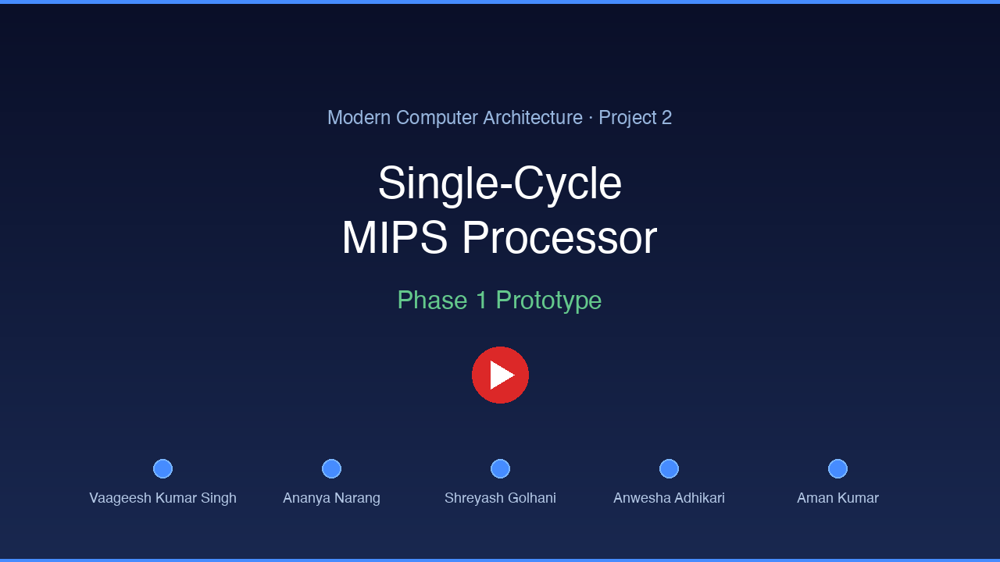
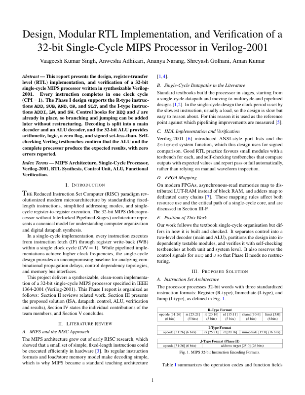
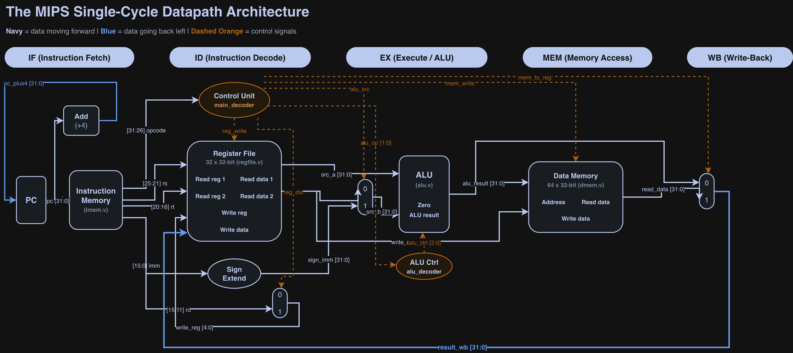

<div align="center">

# 32-bit Single-Cycle MIPS Processor

**A complete synthesizable 32-bit Harvard-architecture single-cycle MIPS CPU in Verilog-2001**

Modern Computer Architecture · Project 2: Single-Cycle MIPS Processor with Memory Interface

[](#results)
[](rtl/)
[](docs/ports.md)
[](docs/ports.md)
[](tb/)

<table>
  <tr>
    <td align="center" width="50%">
      <a href="https://drive.google.com/file/d/1MFVppQq7SBsJbisvDDP2NBADeqdvfY-x/view?usp=sharing"></a>
      <br><b><a href="https://drive.google.com/file/d/1MFVppQq7SBsJbisvDDP2NBADeqdvfY-x/view?usp=sharing">▶ Watch the prototype video</a></b>
      <br>5 min · all five members present their work
    </td>
    <td align="center" width="50%">
      <a href="docs/Report.pdf"></a>
      <br><b><a href="docs/Report.pdf">Read the IEEE report (PDF)</a></b>
      <br>Full technical report with references
    </td>
  </tr>
</table>

[Architecture Spec](docs/ports.md) · [Control & ALU Notes](docs/control_alu_notes.md) · [Verification Guide](docs/verification_notes.md) · [Results](#results) · [Team](#team)

</div>

---

## Phase 1 Deliverables

| Deliverable | Description & Location | Status |
|---|---|:---:|
| **IEEE Technical Report** | Abstract, literature review, proposed architecture, individual contributions, references (`reports/`) | Ready |
| **Prototype Demonstration Video** | 5-minute technical walkthrough: architecture, control table, ALU signed math, memory operations, and live simulation | Recorded / Outlined |
| **Synthesizable RTL Core** | Pure Verilog-2001 datapath, Harvard memory interfaces, 2-level control unit ([`rtl/`](rtl/)) | Complete |
| **Verification & Testbenches** | Self-checking testbenches with cycle-by-cycle logging and assertion tracking ([`tb/`](tb/)) | Complete |
| **Software Benchmark Programs** | Machine code hex files and assembly test programs ([`programs/`](programs/)) | Complete |
| **Simulation Waveforms** | VCD dump (`tb_mips_cpu.vcd`) for GTKWave timing analysis | Generated |
| **Individual Contributions** | Documented in Section VII of the report and the [Team Table](#team) below | Complete |

---

## Architecture Overview

A **single-cycle MIPS processor** executes every instruction in exactly one clock cycle ($CPI = 1$). The architecture adheres to the standard **Harvard memory model**, separating Instruction Memory (`imem`) from Data Memory (`dmem`) to eliminate structural hazards during simultaneous instruction fetching and data load/store operations.

<div align="center">



*Navy = data moving forward · Blue = data going back (write-back) · Dashed Orange = control signals*

</div>

### Supported Instruction Set (Phase I)

The current implementation supports fundamental arithmetic, logical, immediate, and memory access instructions:

- **R-Type:** `ADD`, `SUB`, `AND`, `OR`, `SLT` (all sharing opcode `0x00`, decoded via 6-bit `funct`).
- **I-Type Arithmetic / Immediate:** `ADDI` (16-bit signed immediate addition).
- **I-Type Memory Access:** `LW` (Load Word from data RAM) and `SW` (Store Word into data RAM).
- **Phase II Reserved:** `BEQ` (Branch on Equal) and `J` (Unconditional Jump) control signals are routed and held at safe inactive defaults.

### Five Stages Executed in One Clock Cycle

1. **Instruction Fetch (IF):** PC supplies address to combinational `imem`. $PC + 4$ is computed concurrently.
2. **Instruction Decode (ID):** Instruction fields are parsed; register file ports `rs` and `rt` are read; 16-bit immediate is sign-extended.
3. **Execution (EX):** ALU operates on `rs` and either `rt` or `sign_imm` (selected by `alu_src`).
4. **Memory Access (MEM):** Data memory reads or writes at address `alu_result` on memory instructions.
5. **Write-Back (WB):** Register destination (`rd` or `rt`) is updated with either ALU result or loaded memory word on the next rising clock edge.

---

## Implementation Status

| Module / Component | Source File | Description | Status |
|---|---|---|:---:|
| **Program Counter (PC)** | [`rtl/pc.v`](rtl/pc.v) | Synchronous reset register holding 32-bit PC; combinational $PC + 4$ adder | Verified |
| **Instruction Memory** | [`rtl/imem.v`](rtl/imem.v) | 64-word (256-byte) combinational ROM loaded via `$readmemh` | Verified |
| **Register File** | [`rtl/regfile.v`](rtl/regfile.v) | 32 × 32-bit dual-read combinational, single-write synchronous; `$0` hardwired to `0` | Verified |
| **Sign Extension** | [`rtl/sign_extend.v`](rtl/sign_extend.v) | 16-bit to 32-bit sign replicator (`{{16{in[15]}}, in}`) | Verified |
| **Multiplexer (2:1)** | [`rtl/mux2.v`](rtl/mux2.v) | Parameterized $N$-bit 2-to-1 data multiplexer | Verified |
| **Arithmetic Logic Unit** | [`rtl/alu.v`](rtl/alu.v) | 32-bit execution unit (`AND`, `OR`, `ADD`, `SUB`, signed `SLT`, `zero` flag) | Verified |
| **Main Decoder** | [`rtl/main_decoder.v`](rtl/main_decoder.v) | Decodes 6-bit opcode into datapath control vectors | Verified |
| **ALU Decoder** | [`rtl/alu_decoder.v`](rtl/alu_decoder.v) | Decodes 2-bit `alu_op` and 6-bit `funct` into 3-bit `alu_ctrl` | Verified |
| **Control Unit** | [`rtl/control_unit.v`](rtl/control_unit.v) | Hierarchical top-level control wrapper | Verified |
| **Data Memory** | [`rtl/dmem.v`](rtl/dmem.v) | 64-word internal RAM; synchronous write, combinational read | Verified |
| **Top-Level CPU** | [`rtl/mips_cpu.v`](rtl/mips_cpu.v) | Structural integration of datapath, memory interfaces, and control logic | Verified |
| **Full System Testbench** | [`tb/tb_mips_cpu.v`](tb/tb_mips_cpu.v) | Automated end-to-end self-checking verification suite with VCD dumps | Verified |

---

## Quick Start & Simulation

### Prerequisites
- **Icarus Verilog (`iverilog`, `vvp`)** — RTL compilation and simulation runtime.
- **GTKWave / Surfer** — Waveform viewer (`.vcd`).

### 1. Run the Full Processor Testbench
Execute from the repository root:
```bash
# Compile and simulate complete CPU with all test suites
iverilog -o sim_mips_cpu tb/tb_mips_cpu.v rtl/*.v
vvp sim_mips_cpu
```

### 2. Run Isolated Unit Testbenches
```bash
# Verify 32-bit ALU operations, signed arithmetic, and zero flag
iverilog -o sim_alu tb/tb_alu.v rtl/alu.v && vvp sim_alu

# Verify Program Counter incrementing and Instruction Fetch
iverilog -o sim_fetch tb/tb_fetch.v rtl/pc.v rtl/imem.v && vvp sim_fetch

# Verify Control Unit truth tables
iverilog -o sim_ctrl tb/tb_control_c.v rtl/control_unit.v rtl/main_decoder.v rtl/alu_decoder.v && vvp sim_ctrl
```

### 3. Open Simulation Waveforms
```bash
gtkwave tb_mips_cpu.vcd
```
Add `clk`, `reset`, `pc_out`, `instr`, `alu_result`, `reg_write`, `mem_write`, and `result_wb` to inspect cycle-by-cycle execution.

---

## Verification & Results

Verification is implemented using self-checking testbenches with programmatic assertions (`check_reg`, `check_mem`) to compare hardware state against architectural expectations.

### Test Matrix

| Test Suite | File | Checks | Scope & Coverage | Status |
|---|---|:---:|---|:---:|
| **ALU Unit Test** | [`tb/tb_alu.v`](tb/tb_alu.v) | **36 / 36** | Signed additions, subtractions, logical bitwise operations, signed `SLT` corner cases (`-10 < 20`, `20 < -10`), zero-flag triggers | **PASS** |
| **Fetch Unit Test** | [`tb/tb_fetch.v`](tb/tb_fetch.v) | **Sequential** | Synchronous reset to `0x00`, $+4$ PC address sequencing, hex ROM loading | **PASS** |
| **Control Unit Test** | [`tb/tb_control_c.v`](tb/tb_control_c.v) | **All opcodes** | Control signal truth tables for R-type, `LW`, `SW`, `ADDI`, and safe NOP fallback | **PASS** |
| **Baseline CPU Test** | [`tb/tb_mips_cpu.v`](tb/tb_mips_cpu.v) | **6 / 6** | Execution of `programs/test.hex` (`ADDI`, `ADD`, `SW`, `LW`, `$0` zero integrity) | **PASS** |
| **Comprehensive CPU Test** | [`tb/tb_mips_cpu.v`](tb/tb_mips_cpu.v) | **21 / 21** | Execution of `programs/test_full.hex` (all R-type, signed immediate, signed SLT, multi-word load/store) | **PASS** |
| **Total Automated Assertions** | | **63 / 63** | **Zero simulation errors, 100% functional match** | **PASS** |

### Execution Trace: Comprehensive Program (`programs/test_full.asm`)

```text
================================================================================
   PART 2: RUNNING COMPREHENSIVE TEST PROGRAM (programs/test_full.hex)          
================================================================================
Cycle 00: PC=0x00 | Instr=0x20080014 | ALU Res=20  | RegWr=1 (wa3=$8,  wd3=20)  | MemWr=0
Cycle 01: PC=0x04 | Instr=0x20090005 | ALU Res=5   | RegWr=1 (wa3=$9,  wd3=5)   | MemWr=0
Cycle 02: PC=0x08 | Instr=0x200afff6 | ALU Res=-10 | RegWr=1 (wa3=$10, wd3=-10) | MemWr=0
Cycle 03: PC=0x0c | Instr=0x01095820 | ALU Res=25  | RegWr=1 (wa3=$11, wd3=25)  | MemWr=0
Cycle 04: PC=0x10 | Instr=0x010a6020 | ALU Res=10  | RegWr=1 (wa3=$12, wd3=10)  | MemWr=0
Cycle 05: PC=0x14 | Instr=0x01096822 | ALU Res=15  | RegWr=1 (wa3=$13, wd3=15)  | MemWr=0
Cycle 06: PC=0x18 | Instr=0x01287022 | ALU Res=-15 | RegWr=1 (wa3=$14, wd3=-15) | MemWr=0
Cycle 07: PC=0x1c | Instr=0x01097824 | ALU Res=4   | RegWr=1 (wa3=$15, wd3=4)   | MemWr=0
Cycle 08: PC=0x20 | Instr=0x01098025 | ALU Res=21  | RegWr=1 (wa3=$16, wd3=21)  | MemWr=0
Cycle 09: PC=0x24 | Instr=0x0128882a | ALU Res=1   | RegWr=1 (wa3=$17, wd3=1)   | MemWr=0
Cycle 10: PC=0x28 | Instr=0x0109902a | ALU Res=0   | RegWr=1 (wa3=$18, wd3=0)   | MemWr=0
Cycle 11: PC=0x2c | Instr=0x0148982a | ALU Res=1   | RegWr=1 (wa3=$19, wd3=1)   | MemWr=0
Cycle 12: PC=0x30 | Instr=0x010aa02a | ALU Res=0   | RegWr=1 (wa3=$20, wd3=0)   | MemWr=0
Cycle 13: PC=0x34 | Instr=0xac0b0000 | ALU Res=0   | RegWr=0 (wa3=$11, wd3=0)   | MemWr=1 [SW mem[0]=25]
Cycle 14: PC=0x38 | Instr=0xac0d0004 | ALU Res=4   | RegWr=0 (wa3=$13, wd3=0)   | MemWr=1 [SW mem[1]=15]
Cycle 15: PC=0x3c | Instr=0xac0e0008 | ALU Res=8   | RegWr=0 (wa3=$14, wd3=0)   | MemWr=1 [SW mem[2]=-15]
Cycle 16: PC=0x40 | Instr=0xac11000c | ALU Res=12  | RegWr=0 (wa3=$17, wd3=0)   | MemWr=1 [SW mem[3]=1]
Cycle 17: PC=0x44 | Instr=0x8c150000 | ALU Res=0   | RegWr=1 (wa3=$21, wd3=25)  | MemWr=0 [LW $s5=25]
Cycle 18: PC=0x48 | Instr=0x8c160004 | ALU Res=4   | RegWr=1 (wa3=$22, wd3=15)  | MemWr=0 [LW $s6=15]
Cycle 19: PC=0x4c | Instr=0x8c170008 | ALU Res=8   | RegWr=1 (wa3=$23, wd3=-15) | MemWr=0 [LW $s7=-15]
Cycle 20: PC=0x50 | Instr=0x8c18000c | ALU Res=12  | RegWr=1 (wa3=$24, wd3=1)   | MemWr=0 [LW $t8=1]

================================================================================
MIPS CPU VERIFICATION RESULT: ALL 27 CHECKS PASSED! [PASS]
================================================================================
```

---

## Key Engineering Highlights

1. **Deterministic Waveform Design:** For instructions like Store Word (`SW`), don't-care lines (`reg_dst`, `mem_to_reg`) are explicitly tied to `0` rather than `X` to eliminate indeterminate states and unknown propagation in simulation.
2. **Mathematical Rigor in Signed Comparisons:** Standard Verilog `<` treats registers as unsigned. In [`rtl/alu.v`](rtl/alu.v), `SLT` explicitly casts operands with `$signed(a) < $signed(b)`, ensuring `-10 < 20` evaluates to `1` while `20 < -10` evaluates to `0`.
3. **Synthesis Latch Prevention:** All decoders and multiplexers provide complete case coverage and explicit default assignments, guaranteeing clean combinational logic synthesis without unintended latches.
4. **Hardwired Zero Register ($0):** Register `$0` is permanently locked to `32'b0` through combinational multiplexing (`assign rd1 = (ra1 == 5'd0) ? 32'b0 : regs[ra1];`) and write inhibition (`if (we3 && wa3 != 5'd0)`), enforcing MIPS ISA compliance.

---

## Next Steps (Phase II)

- [ ] **Branch & Jump Logic:** Connect `BEQ` target adder ($PC + 4 + (\text{sign\_imm} \ll 2)$), `J` target concatenation ($\{PC_{31:28}, \text{instr}_{25:0}, 2'b00\}$), and branch condition AND gate (`branch & zero`).
- [ ] **Complex Benchmark Algorithms:** Implement and execute iterative programs using branches:
  - Array Summation
  - Maximum Element Search
  - Factorial Computation ($N!$)
- [ ] **FPGA Synthesis & Timing Closure:** Synthesize using Xilinx Vivado to measure LUT utilization, register count, and maximum operating frequency ($F_{\text{max}}$).

---

## Repository Structure

```text
.
├── docs/                       # Architecture and interface specifications
│   ├── ports.md                # Bit-width and interface contract for all modules
│   ├── control_alu_notes.md    # Control truth tables, report section, video highlights
│   ├── verification_notes.md   # Verification matrix, execution trace, assertion log
│   ├── datagram_diagram.png    # Full datapath architecture diagram
│   └── Report.pdf              # IEEE Phase 1 technical report
├── media/phase1/               # Thumbnail images for README cards
│   ├── video_thumbnail.png     # Video title slide thumbnail
│   └── report_thumbnail.png    # Report first-page thumbnail
├── programs/                   # Assembly and hex test programs
│   ├── test.asm                # 5-instruction smoke test program
│   ├── test.hex                # Assembled machine code for test.asm
│   ├── test_full.asm           # 21-instruction comprehensive test program
│   └── test_full.hex           # Assembled machine code for test_full.asm
├── rtl/                        # Synthesizable Verilog-2001 RTL modules
│   ├── alu.v                   # 32-bit Arithmetic Logic Unit
│   ├── alu_decoder.v           # Secondary decoder for R-type funct codes
│   ├── control_unit.v          # Top-level control wrapper
│   ├── dmem.v                  # 64-word Data Memory RAM
│   ├── imem.v                  # 64-word Instruction Memory ROM
│   ├── main_decoder.v          # Primary opcode decoder
│   ├── mips_cpu.v              # Top-level single-cycle CPU datapath
│   ├── mux2.v                  # Parameterized 2:1 multiplexer
│   ├── pc.v                    # Program Counter register & PC+4 adder
│   ├── regfile.v               # 32x32-bit Register File ($0 hardwired to 0)
│   └── sign_extend.v           # 16-to-32 bit sign extender
├── tb/                         # Simulation testbenches
│   ├── tb_alu.v                # 36-test unit verification of ALU
│   ├── tb_control_c.v          # Control unit truth-table verification
│   ├── tb_fetch.v              # PC increment and instruction fetch testbench
│   └── tb_mips_cpu.v           # End-to-end CPU self-checking testbench
└── README.md                   # Project documentation and user guide
```

---

## Team & Individual Contributions

| Member | Role | Assigned Files & Work Scope | Phase 1 Contributions |
|---|---|---|---|
| **Vaageesh Kumar Singh**<br>(Member A) | **Fetch & Top-Level Architecture (Lead)** | [`rtl/pc.v`](rtl/pc.v), [`rtl/imem.v`](rtl/imem.v), [`rtl/mips_cpu.v`](rtl/mips_cpu.v), [`docs/ports.md`](docs/ports.md) | Designed Program Counter with synchronous reset, instruction memory interface, top-level CPU integration, and overall port specifications. |
| **Ananya Narang**<br>(Member B) | **Datapath & Register Core** | [`rtl/regfile.v`](rtl/regfile.v), [`rtl/sign_extend.v`](rtl/sign_extend.v), [`rtl/mux2.v`](rtl/mux2.v) | Built 32×32-bit register file with hardwired `$0=0`, 16-to-32 immediate sign extension, and parameterized datapath multiplexers. |
| **Shreyash Golhani**<br>(Member C) | **Control Subsystem & Execution Core** | [`rtl/alu.v`](rtl/alu.v), [`rtl/main_decoder.v`](rtl/main_decoder.v), [`rtl/alu_decoder.v`](rtl/alu_decoder.v), [`rtl/control_unit.v`](rtl/control_unit.v), [`docs/control_alu_notes.md`](docs/control_alu_notes.md) | Designed 2-level hierarchical control unit, opcode/funct decoding tables, 32-bit ALU with signed comparison logic, and zero flag. |
| **Anwesha Adhikari**<br>(Member D) | **Memory Subsystem & Write-Back Interface** | [`rtl/dmem.v`](rtl/dmem.v), [`rtl/mips_cpu.v`](rtl/mips_cpu.v), memory interface documentation | Implemented byte-to-word data memory interface, synchronous store/combinational load datapath, and write-back multiplexer routing. |
| **Aman Kumar**<br>(Member E) | **Verification Suite & Software Benchmarks** | [`tb/tb_mips_cpu.v`](tb/tb_mips_cpu.v), [`tb/tb_alu.v`](tb/tb_alu.v), [`tb/tb_fetch.v`](tb/tb_fetch.v), [`programs/`](programs/), [`docs/verification_notes.md`](docs/verification_notes.md) | Authored self-checking automated testbenches, generated VCD waveforms, developed baseline and comprehensive MIPS test programs in assembly/hex. |
